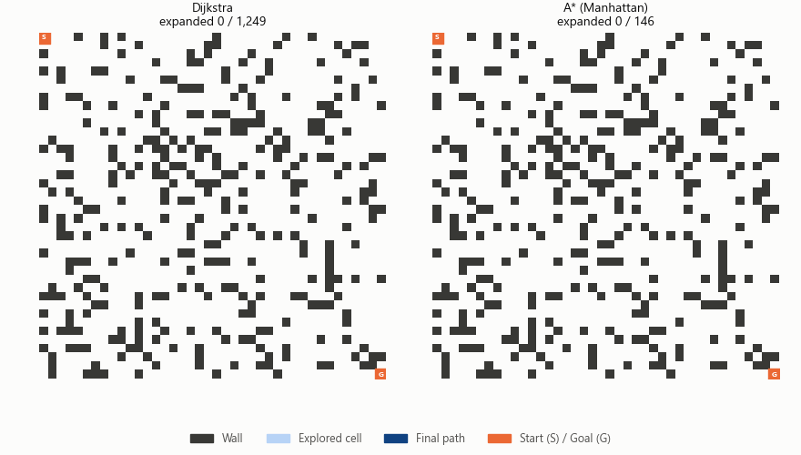
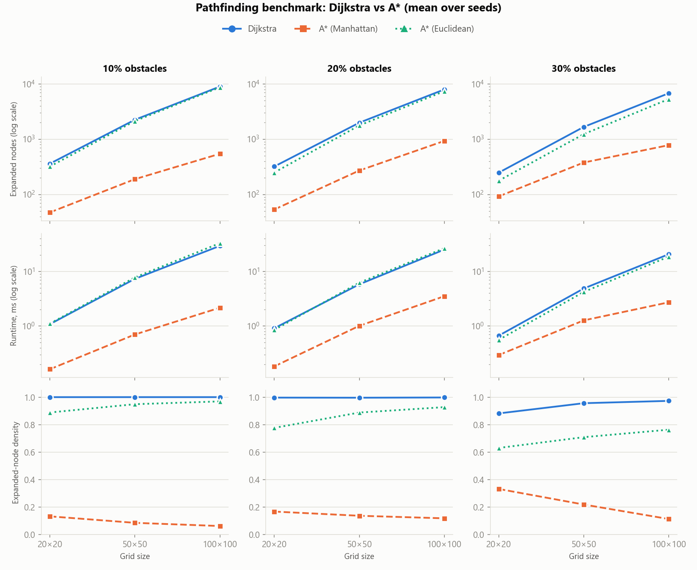
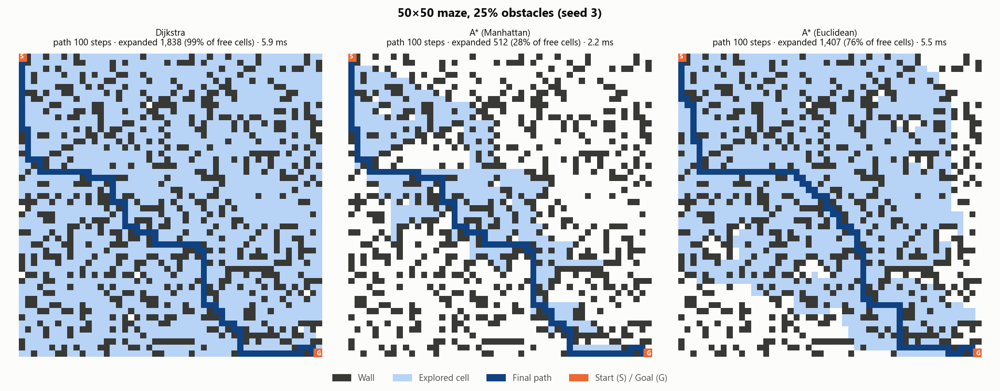

<div align="center">

# 🧭 Pathfinding Algorithm Visualizer

**Dijkstra's algorithm vs A\* search on random grid mazes, written from scratch with NumPy and Matplotlib.**




<sub>Dijkstra (left) floods outward in every direction; A\* (right) heads for the goal. Both find the same shortest path.</sub>

</div>

---

## 📑 Table of Contents

- [Overview](#-overview)
- [How the algorithms work](#-how-the-algorithms-work)
- [Quick Start](#-quick-start)
- [Usage as a library](#-usage-as-a-library)
- [Experiment design](#-experiment-design)
- [Results](#-results)
- [Key findings](#-key-findings)
- [Output files](#-output-files)
- [Testing](#-testing)
- [Limitations](#-limitations)
- [Project Structure](#-project-structure)

---

## 🔎 Overview

A small search framework in which a virtual agent finds the shortest route through a grid maze. It
implements **Dijkstra's algorithm** and **A\* search** from scratch (no graph libraries), generates mazes of
different sizes and obstacle densities, solves every maze with every algorithm under identical conditions,
records performance metrics, and exports images, charts and an animation of the search.

**Highlights**

- 🧩 Both algorithms written from scratch on a `heapq` priority queue, sharing one search loop.
- 📐 Two A\* heuristics compared: **Manhattan** and **Euclidean**.
- 🎲 Reproducible random mazes: the same seed always gives the same maze, and every maze is guaranteed solvable.
- 📊 Metrics per run: **path length**, **runtime**, **expanded nodes** and **expanded-node density**.
- 🖼️ Exported maze images, benchmark charts, an animated GIF, and CSV/JSON logs.
- ✅ 49 unit tests, including an independent BFS check that every path is truly the shortest.

---

## 🧠 How the algorithms work

The agent moves up, down, left or right on a grid; each step costs 1. Walls cannot be crossed.

Both algorithms are the same **best-first search**. They keep a priority queue of cells to visit and always
expand the cell with the lowest priority. The only difference is how priority is computed:

| Algorithm | Priority of a cell | Behaviour |
|-----------|--------------------|-----------|
| **Dijkstra** | `g` (steps taken so far) | Explores outward evenly in all directions; no sense of where the goal is. |
| **A\*** | `g + h` (steps so far + estimated steps left) | Is pulled toward the goal by the heuristic `h`, so it explores far fewer cells. |

With `h = 0`, A\* turns into Dijkstra. Both algorithms return a **shortest path** as long as `h` never
overestimates the true remaining cost (it is *admissible*).

| Heuristic | Formula | Notes |
|-----------|---------|-------|
| **Manhattan** | `\|Δrow\| + \|Δcol\|` | Exact on an empty 4-connected grid, so it guides the search well. |
| **Euclidean** | `√(Δrow² + Δcol²)` | Admissible but often much smaller than the real cost on a grid, so it guides the search weakly. |

**Implementation details**

- Ties on priority are broken in favour of the smaller `h`, which nudges A\* toward the goal.
- Stale queue entries are skipped (lazy deletion), so a cell is expanded at most once.
- Each run returns the path, expanded nodes, expanded density, runtime and the **order** in which cells were expanded (used for the visualizations).

---

## 🚀 Quick Start

```bash
# 1. Create and activate a virtual environment
python -m venv .venv
.venv\Scripts\activate          # Windows
# source .venv/bin/activate     # macOS / Linux

# 2. Install dependencies
pip install -r requirements.txt

# 3. Run the full experiment (about 15 seconds)
python main.py

# Or a fast smoke test
python main.py --quick
```

All outputs are written to `results/`.

---

## 🐍 Usage as a library

```python
from pathfinding import generate_maze, dijkstra, astar

grid, start, goal = generate_maze(rows=50, cols=50, density=0.25, seed=3)

result = astar(grid, start, goal, heuristic="manhattan")   # or "euclidean"
print(result.path_length, result.expanded_nodes, result.expanded_density, result.runtime_s)

baseline = dijkstra(grid, start, goal)
assert baseline.path_length == result.path_length          # both are optimal
```

`grid` is a NumPy array (`0` = free, `1` = wall); `start` is the top-left and `goal` the bottom-right cell.

---

## 🧪 Experiment design

| Setting | Values |
|---------|--------|
| Grid sizes | 20×20, 50×50, 100×100 |
| Obstacle density | 10%, 20%, 30% of cells are walls |
| Mazes per setting | 10 random seeds (0–9) |
| Algorithms | Dijkstra, A\* (Manhattan), A\* (Euclidean) |
| Total runs | 3 sizes × 3 densities × 10 seeds × 3 algorithms = **270** |

- **Same maze for every algorithm**, so the comparison is fair.
- **Runtime** is the median of 5 repeats per run to reduce timing noise; the other metrics are deterministic.
- **Expanded-node density** = expanded nodes ÷ free cells in the maze. A value of 1.0 means the algorithm visited every open cell.
- The benchmark raises an error if the algorithms ever disagree on path length. They never did.

---

## 📈 Results

All numbers are means over 10 mazes. Raw data: [`results/benchmark_results.csv`](results/benchmark_results.csv),
averages: [`results/benchmark_summary.csv`](results/benchmark_summary.csv).



### Expanded nodes (lower is better)

| Grid | Walls | Dijkstra | A\* Manhattan | A\* Euclidean | Dijkstra ÷ A\* Manhattan |
|------|------:|---------:|--------------:|--------------:|-------------------------:|
| 20×20 | 10% | 361.6 | 47.4 | 321.2 | 7.6× |
| 20×20 | 20% | 321.3 | 53.6 | 250.2 | 6.0× |
| 20×20 | 30% | 248.8 | 92.5 | 177.9 | 2.7× |
| 50×50 | 10% | 2,253.7 | 189.4 | 2,137.7 | 11.9× |
| 50×50 | 20% | 1,995.4 | 271.7 | 1,778.9 | 7.3× |
| 50×50 | 30% | 1,672.9 | 379.3 | 1,240.2 | 4.4× |
| 100×100 | 10% | 8,989.4 | 545.7 | 8,709.8 | 16.5× |
| 100×100 | 20% | 7,977.1 | 932.9 | 7,413.4 | 8.6× |
| 100×100 | 30% | 6,806.8 | 782.2 | 5,338.1 | 8.7× |

### Expanded-node density (share of free cells visited)

| Grid | Walls | Dijkstra | A\* Manhattan | A\* Euclidean |
|------|------:|---------:|--------------:|--------------:|
| 20×20 | 10% | 1.000 | 0.131 | 0.888 |
| 20×20 | 30% | 0.881 | 0.331 | 0.630 |
| 50×50 | 10% | 1.000 | 0.084 | 0.948 |
| 50×50 | 30% | 0.956 | 0.217 | 0.708 |
| 100×100 | 10% | 1.000 | 0.061 | 0.969 |
| 100×100 | 30% | 0.973 | 0.112 | 0.763 |

### Runtime in milliseconds (lower is better)

| Grid | Walls | Dijkstra | A\* Manhattan | A\* Euclidean | Dijkstra ÷ A\* Manhattan |
|------|------:|---------:|--------------:|--------------:|-------------------------:|
| 20×20 | 10% | 1.08 | 0.16 | 1.11 | 6.7× |
| 50×50 | 10% | 7.33 | 0.70 | 7.79 | 10.5× |
| 100×100 | 10% | 29.49 | 2.17 | 33.08 | 13.6× |
| 100×100 | 20% | 25.22 | 3.52 | 26.74 | 7.2× |
| 100×100 | 30% | 20.75 | 2.73 | 18.75 | 7.6× |

### Mean shortest-path length (steps)

| Grid | 10% walls | 20% walls | 30% walls |
|------|----------:|----------:|----------:|
| 20×20 | 38 | 38 | 40 |
| 50×50 | 98 | 98 | 101.8 |
| 100×100 | 198 | 198 | 201.8 |

All three algorithms returned identical path lengths on every maze. The shortest possible path on an empty
`n×n` grid is `2(n−1)` steps, so obstacles add little to it here.

### Example mazes

Each image shows what every algorithm explored (light blue) before finding the final path (dark blue).

| Maze | Dijkstra expanded | A\* Manhattan expanded | A\* Euclidean expanded |
|------|------------------:|-----------------------:|-----------------------:|
| [30×30, 10% walls](results/maze_30x30_10pct.png) | 805 | 156 | 753 |
| [50×50, 25% walls](results/maze_50x50_25pct.png) | 1,838 | 512 | 1,407 |
| [100×100, 30% walls](results/maze_100x100_30pct.png) | 6,887 | 674 | 5,649 |



---

## 💡 Key findings

1. **A\* with the Manhattan heuristic is the clear winner.** It found the same optimal paths while expanding
   **2.7× to 16.5× fewer nodes** and running **2.3× to 13.6× faster** than Dijkstra.
2. **The advantage grows with grid size.** On open, large grids Dijkstra visits almost every free cell
   (density about 1.0), while A\* Manhattan visits only 6% of them on 100×100 mazes with 10% walls.
3. **Heuristic quality matters.** Euclidean distance is admissible, so it stays optimal, but on a grid where
   the agent cannot move diagonally it underestimates the true cost. It performs close to Dijkstra:
   8,710 vs 8,989 expanded nodes on 100×100 mazes with 10% walls.
4. **Walls generally narrow the gap.** With more obstacles the free space is more constrained, so Dijkstra has less
   to explore and A\* has less to save (for example 2.7× at 20×20 with 30% walls vs 7.6× with 10% walls; at 100×100 the 20% and 30% cases are about equal, 8.6× and 8.7×).
5. **Fewer expansions mean less time here.** Runtime follows expanded nodes closely, so the extra cost of
   computing a heuristic is small compared with the cells saved.

---

## 📦 Output files

| File | Contents |
|------|----------|
| `results/benchmark_results.csv` | One row per run: size, density, seed, algorithm, path length, expanded nodes, density, runtime |
| `results/benchmark_summary.csv` / `.json` | Metrics averaged over seeds per size, density and algorithm |
| `results/benchmark_summary.png` | Charts of expanded nodes, runtime and density by grid size and obstacle density |
| `results/maze_*.png` | Side-by-side maze images showing explored cells and the final path |
| `results/search_animation.gif` | Animated search, Dijkstra vs A\* (Manhattan) |

Charts use a color-blind-checked palette, and each algorithm also has its own marker and line style, so
nothing depends on color alone.

---

## ✅ Testing

```bash
python -m pytest
```

49 tests cover:

- **Optimality:** all three solvers match an independent breadth-first-search shortest-path length on random mazes, and every returned path is checked step by step (adjacent cells, no walls, correct endpoints).
- **Edge cases:** unreachable goal, start equals goal, a wall used as start or goal.
- **Efficiency:** A\* expands fewer nodes than Dijkstra on an open grid.
- **Maze generator:** reproducible for a seed, always solvable, rejects invalid input.
- **Benchmark and plots:** correct row counts and averages, and the CSV, JSON, PNG and GIF files are created.

---

## ⚠️ Limitations

- Movement is **4-directional with uniform cost**; diagonal moves and weighted terrain are not modelled.
- Mazes are **random obstacle fields** (not corridor-style perfect mazes), with the start and goal fixed at opposite corners.
- Runtimes come from a pure-Python implementation on one machine, so absolute values will vary; the relative comparison is the meaningful part.
- Grid sizes stop at 100×100 to keep the full experiment quick.

**Ideas for extension:** diagonal movement with an octile heuristic, weighted cells, corridor-style mazes,
Jump Point Search, and a Q-learning agent for comparison.

---

## 📁 Project Structure

```
Pathfinding-Algorithm-Visualizer/
├── main.py                  # run the experiment, write everything to results/
├── pathfinding/
│   ├── grid.py              # grid, neighbours, solvable random maze generator
│   ├── algorithms.py        # Dijkstra and A* from scratch
│   ├── benchmark.py         # fair multi-maze benchmark + CSV/JSON export
│   └── visualize.py         # maze images, benchmark charts, GIF
├── results/                 # generated images, charts, logs
├── tests/                   # 49 unit tests
└── requirements.txt         # pinned dependencies
```

Built with Python 3.10 · NumPy · Matplotlib · pytest
